# Magyar közlekedés: felhasználói kézikönyv

[English](README.md) · **Magyar**

Ez a kézikönyv végigveszi a Magyar közlekedés (Hungarian transport)
integráció és a két dashboard-kártya minden képernyőjét. Az **indulási
kártya** két megálló között listázza a következő indulásokat, a **tervező**
pedig útvonalat keres Magyarország bármely két pontja között.

A képek a valódi kártyákról készültek, élő adatokkal, egy 2026. októberi
hétköznap reggelén. A te dashboardodon természetesen más idők, késések és
járművek látszanak.

## Tartalom

1. [Mit tud?](#1-mit-tud)
2. [Telepítés](#2-telepítés)
3. [Az integráció](#3-az-integráció)
4. [Az indulási kártya](#4-az-indulási-kártya)
5. [Egy indulási sor részei](#5-egy-indulási-sor-részei)
6. [Az útvonaltérkép](#6-az-útvonaltérkép)
7. [A tervező](#7-a-tervező)
8. [Elrendezés, nyelv, téma](#8-elrendezés-nyelv-téma)
9. [A menetrendek frissen tartása](#9-a-menetrendek-frissen-tartása)
10. [Hibaelhárítás](#10-hibaelhárítás)
11. [Konfigurációs referencia](#11-konfigurációs-referencia)

---

## 1. Mit tud?

| Rész | Mire való |
| --- | --- |
| **Magyar közlekedés integráció** | Betölti a kártyákat a Home Assistantba, távol tartja a BKK kulcsot a dashboardoktól, és adja a MÁV menetrend-szolgáltatást (vágány, helyjegy). |
| **Indulási kártya** (`custom:hungarian-transport-card`) | A következő indulások egy forrás és egy cél között: BKK, MÁV, Volán vagy egy város helyi hálózata. |
| **Tervező** (`custom:hungarian-transit-stop-card-plan`) | Bármely magyarországi megállót, utcát vagy települést megkereshetsz, és megkapod a köztük induló járatokat élőben, vagy egy választott időpontra az átszállásos útvonalakat. |

Honnan jönnek az adatok:

| Szolgáltatás | Forrás | Élő? |
| --- | --- | --- |
| Budapesti busz, villamos, troli, metró, HÉV, elővárosi vonat | BKK FUTÁR | Igen, valós idejű pozíció és késés |
| MÁV vonatok | BKK FUTÁR Budapest környékén, a vágány és a helyjegy a MÁV ELVIRA-ból | Késés és vágány |
| Volán buszok | A KTI országos GTFS-e, a kártyával együtt települ | Menetrend |
| Helyi hálózatok (Szeged, Pécs, Miskolc, …) | Az üzemeltetők saját GTFS-e, a kártyával együtt települ | Menetrend (Szombathely élőben, a kiegészítő szolgáltatásokkal) |
| Megállókeresés és átszállás | [Transitous](https://transitous.org/), tartalékként a BKK FUTÁR | — |

---

## 2. Telepítés

### 2.1 HACS-szal

1. A HACS menüjében válaszd az **Egyéni tárolók** (Custom repositories)
   pontot.
2. Add hozzá a `https://github.com/bator/hungarian-transport` tárolót
   **Integráció** (Integration) kategóriával.
3. Keresd meg a HACS-ban a **Hungarian transport** tételt, és töltsd le.
4. Indítsd újra a Home Assistantot.
5. **Beállítások → Eszközök és szolgáltatások → Integráció hozzáadása**,
   majd válaszd a **Magyar közlekedés** integrációt.

> Korábban **Dashboard** kategóriájú HACS-tárolóként telepítetted? Előbb
> töröld azt a tárolót, aztán add hozzá újra **Integráció**ként.

Az integráció maga tölti be a kártyát, Lovelace-erőforrást **nem** kell
kézzel felvenni.

### 2.2 A BKK API kulcs

A BKK (budapesti) és a MÁV kártyákhoz ingyenes BKK Open Data kulcs kell. A
Volán és a helyi kártyák kulcs nélkül is működnek.

1. Regisztrálj a <https://opendata.bkk.hu/data-sources> oldalon, és másold
   ki a kulcsot.
2. Add meg az integráció hozzáadásakor, vagy később itt:
   **Beállítások → Eszközök és szolgáltatások → Magyar közlekedés →
   Konfigurálás**.

A kulcs helye az integráció. A kártyák így a Home Assistanton keresztül
érik el a BKK-t: a kulcs nem kerül se a dashboard konfigurációjába, se a
böngészőbe, és a kártyák közösen használnak egy-egy lekérdezést.

Egy kártyának saját kulcsot is adhatsz a kártyaszerkesztőben (lásd
[4.2](#42-a-bkk-kulcs-a-szerkesztőben)). A kártya saját kulcsa erősebb az
integrációénál.

### 2.3 Kézi telepítés (csak a kártya)

Csomagold ki egy [GitHub-kiadás](https://github.com/bator/hungarian-transport/releases)
`hungarian-transport-frontend.zip` fájlját a `/config/www/hungarian-transport/`
mappába, majd vedd fel a `/local/hungarian-transport/hungarian-transport.js`
erőforrást **JavaScript modul** típussal. Így csak a kártyák és a
menetrendek települnek, a MÁV vágány- és helyjegyszolgáltatás nem.

---

## 3. Az integráció

### 3.1 Beállítások

A **Beállítások → Eszközök és szolgáltatások → Magyar közlekedés →
Konfigurálás** egyetlen mezőt nyit meg: **BKK API kulcs**.

- Írj be új kulcsot, és ments: az integráció újratölt, és minden kártya az
  új kulcsot használja.
- Ürítsd ki a mezőt, és ments: a kulcs törlődik.
- A mező gépelés közben is elrejti a kulcsot.

Ha a BKK elutasítja a tárolt kulcsot (visszavonták vagy lejárt), a Home
Assistant újat kér: a **Beállítások → Eszközök és szolgáltatások** oldalon
megjelenik **A BKK kulcsot elutasították** ablak. Ott add meg az új
kulcsot, vagy hagyd üresen, és a BKK-elérés kikapcsol. Addig a kártyák a
hibát mutatják, és nem küldik újra meg újra az elutasított kulcsot.

### 3.2 Javítási üzenetek

Ezek a **Beállítások → Javítások** alatt jelennek meg.

| Üzenet | Jelentése | Teendő |
| --- | --- | --- |
| **Hiányoznak a kártya fájljai** | A kártya fájljai nincsenek ott, ahol az integráció keresi őket. | Telepítsd újra a kiadást a HACS-ból (vagy a kiadás `hungarian-transport.zip` fájljából), majd indítsd újra a rendszert. |
| **Nem készült el a MÁV útvonalindex** | A feltöltött MÁV menetrendből nem sikerült vonatútvonalakat építeni. | Tegyél be új feedet, tölts fel egyet, vagy futtasd a **MÁV útvonalindex újraépítése** műveletet. |

### 3.3 Műveletek

Ezeket a **Fejlesztői eszközök → Műveletek** alatt próbálhatod ki.

| Művelet | Mit csinál |
| --- | --- |
| `hungarian_transport.elvira_between` | **MÁV indulások lekérése** két állomás között, vágánnyal és helyjegyjelzéssel. Két kilencjegyű MÁV állomáskódot és egy előretekintést vár percben (15–480). |
| `hungarian_transport.futar` | **BKK FUTÁR lekérdezés** az integráció kulcsával. A kártyák használják; csak akkor létezik, ha van beállított kulcs. |
| `hungarian_transport.rebuild_mav_index` | **MÁV útvonalindex újraépítése** a `/config/hungarian-transport/mav-gtfs.zip` fájlból, minden járat ellenőrzésével. |

### 3.4 Vonatútvonalak a térképen (opcionális)

Külön adat nélkül egy vonat térképe élő lekérdezésre támaszkodik, ami néha
nem talál semmit. A MÁV a teljes menetrendjét (GTFS, CC0 licenc)
regisztrált felhasználóknak adja ki. Ezzel Magyarország minden vonata a
saját útvonalát rajzolja.

1. Regisztrálj a <https://www.mavcsoport.hu/gtfs-igenybejelento> oldalon.
   A MÁV e-mailben küld letöltési címet és belépési adatokat.
2. Töltsd le a `gtfsMavMenetrend.zip` fájlt.
3. Tedd ide: `/config/hungarian-transport/mav-gtfs.zip`. Például a **File
   editor** alkalmazással: nyisd meg (vagy hozd létre) a
   `hungarian-transport` mappát, töltsd fel a fájlt, és nevezd át
   `mav-gtfs.zip`-re.
4. Indítsd újra a Home Assistantot, vagy futtasd a **MÁV útvonalindex
   újraépítése** műveletet.

Az építés minden járatot ellenőriz: minden állomásnak a kirajzolt
útvonaltól legfeljebb 300 méterre kell lennie. Ha az ellenőrzés elbukik, az
előző index marad használatban, és egy értesítés megmondja, miért. A sínen
pontosan futó útvonalakhoz lásd a menetrend-útmutató
[MÁV train routes](../timetables.md#máv-train-routes) részét.

---

## 4. Az indulási kártya

### 4.1 A kártya hozzáadása

1. Nyiss meg egy dashboardot: **Irányítópult szerkesztése → Kártya
   hozzáadása**.
2. Keress rá a **Hungarian transport** kártyára, és válaszd ki.

A szerkesztő mellett ott a kártya élő előnézete. Amíg nincs kiválasztva két
megálló, az előnézet erre kér.

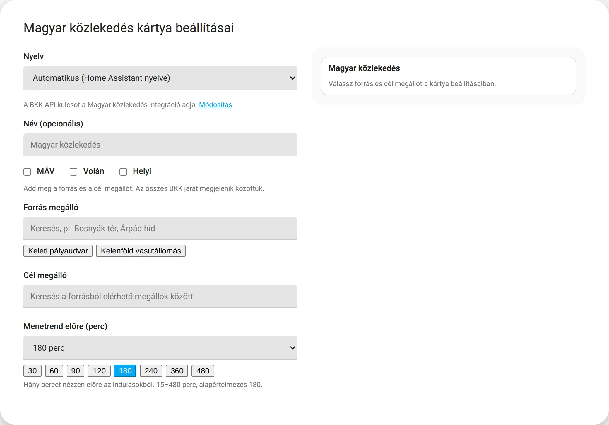

A szerkesztő mezői fentről lefelé:

| Mező | Mire való |
| --- | --- |
| **Nyelv** | Az *Automatikus* a Home Assistant nyelvét követi. Rögzítheted a magyart vagy az angolt. |
| BKK API kulcs sor | Megmutatja, honnan jön a kulcs. A *Módosítás* megnyitja a kulcsmezőt. |
| **Név (opcionális)** | A kártya címe. Üresen „forrás → cél”. A szerkesztő kitölti a megállók kiválasztásakor, de a magad írta címet megtartja. |
| **MÁV / Volán / Helyi** | Az üzemmód. Ha egyik sincs bepipálva, budapesti BKK. Egyszerre csak egy lehet bekapcsolva. |
| **Város** | Csak Helyi módban: melyik város hálózata. |
| **Forrás megálló** | Keresőmező, a fő csomópontokra gyorsgombokkal. |
| **Cél megálló** | Csak azok a megállók, ahová a forrásból tényleg eljut egy jármű. |
| **Menetrend előre (perc)** | Milyen messzire nézzen előre a kártya. 30 és 480 perc között gyorsgombok is vannak. |

### 4.2 A BKK kulcs a szerkesztőben

Ha az integrációban van kulcs, a szerkesztő csak ennyit ír ki (lásd a fenti
képet). Ha nincs, megjelenik a **BKK API kulcs** mező, mellette az ingyenes
regisztráció linkje. A **Mutat** gombbal láthatod, amit beírtál.

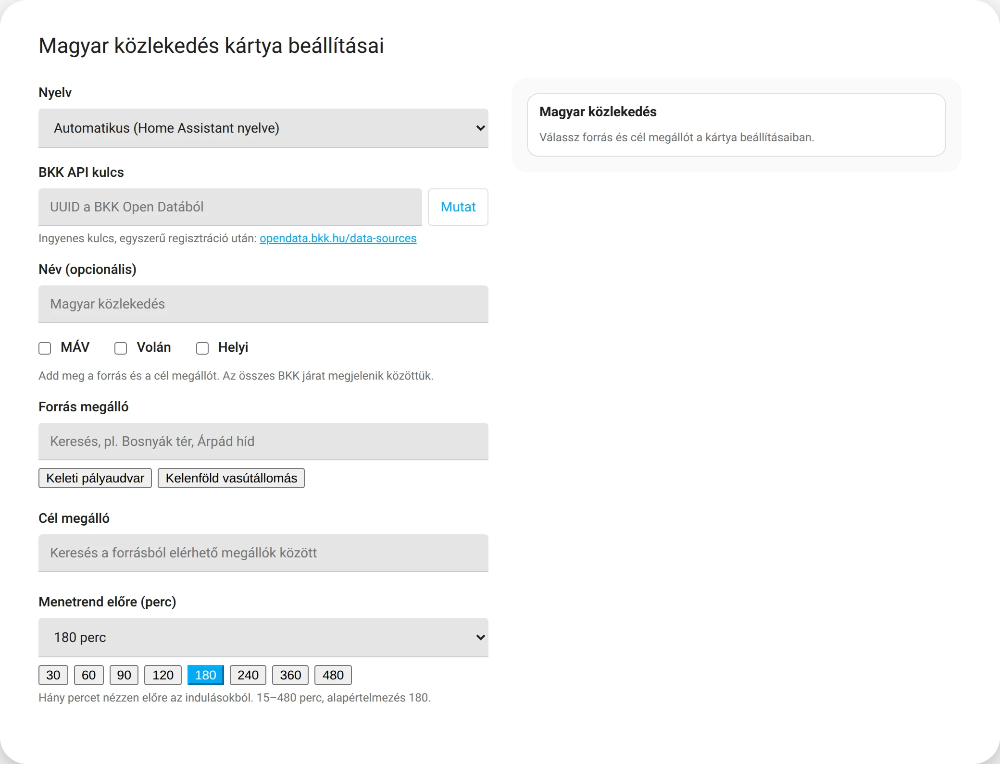

Ha a kulcs működik, a mező összecsukódik, és egy **Módosítás** link marad.
Ha a BKK elutasítja, a mező hibaüzenettel visszajön.

Ha az integrációban nincs kulcs, a szerkesztő a keresésekhez kölcsönveszi egy
másik kártya kulcsát ugyanezen a műszerfalon, és ezt ki is írja; az új
kártyába nem menti el. A kártyán megadott kulcs elavult: amíg a kártya
YAML-jében van kulcs, a szerkesztő minden módban figyelmeztet erre.

### 4.3 A négy üzemmód

| Mód | Mit mutat | Kell BKK kulcs? |
| --- | --- | --- |
| *(nincs bepipálva)* BKK | Budapesti busz, villamos, troli, metró, HÉV | Igen |
| **MÁV** | Vonatok két állomás között | Igen |
| **Volán** | Távolsági és regionális buszok | Nem |
| **Helyi** | Egy város saját hálózata | Nem |

### 4.4 Lépésről lépésre: egy MÁV kártya

Pipáld be a **MÁV** módot, és kezdd el beírni az állomás nevét. Az
üzemmód-kapcsolók alatti tipp megmondja, mit kell választani.

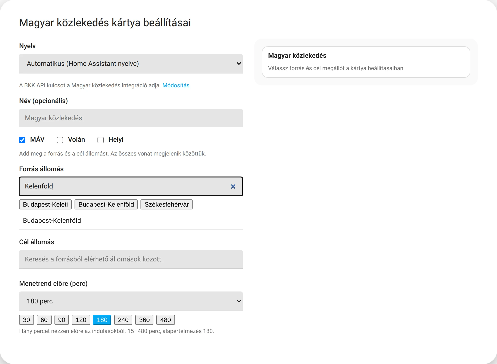

Kattints az állomásra. Utána kattints a **Cél állomás** mezőbe: a lista
minden olyan állomást mutat, ahová a forrásból közvetlen vonat megy.
Gépeléssel szűrheted.

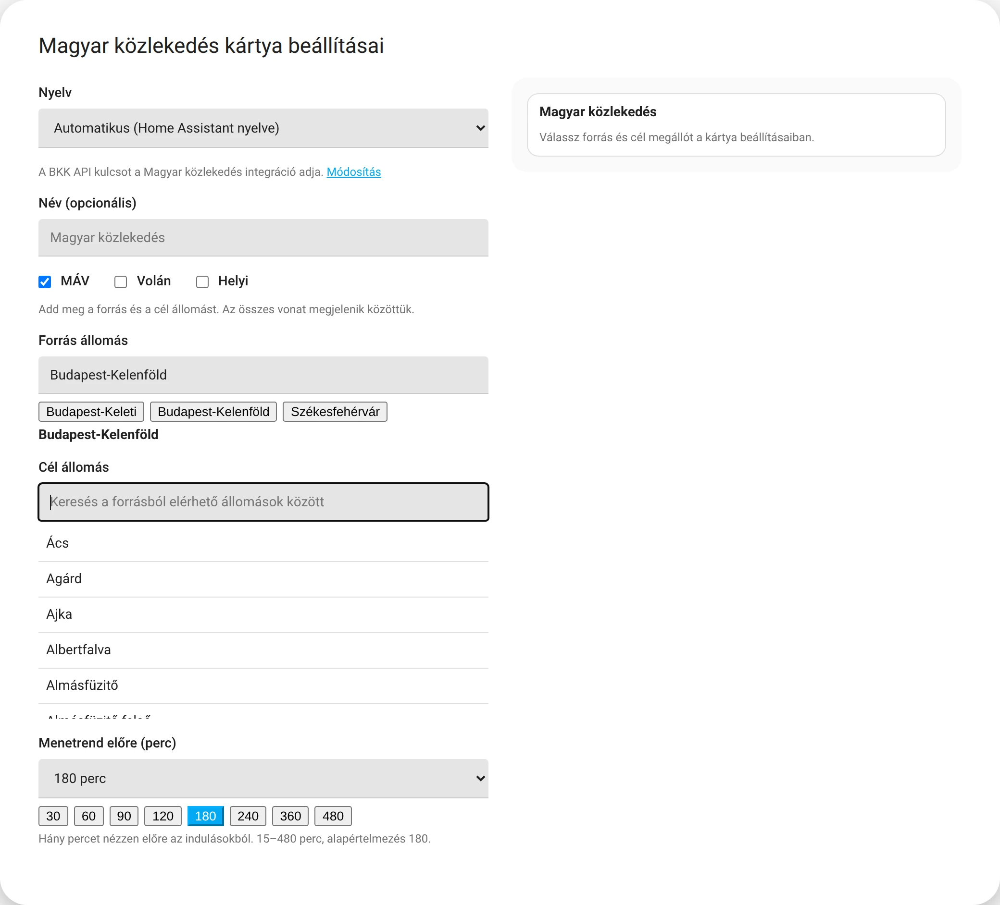

Válaszd ki a célt. A kártya címe „forrás → cél” lesz, és az előnézetben
megjelennek a következő vonatok.

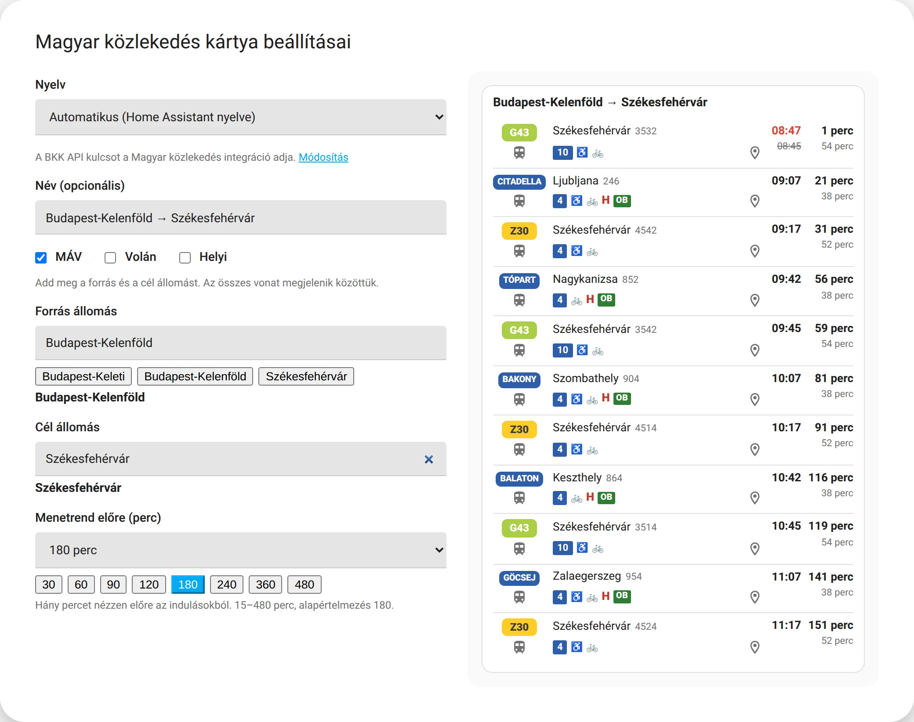

Kattints a **Mentés** gombra. A kártya a dashboardon így néz ki:

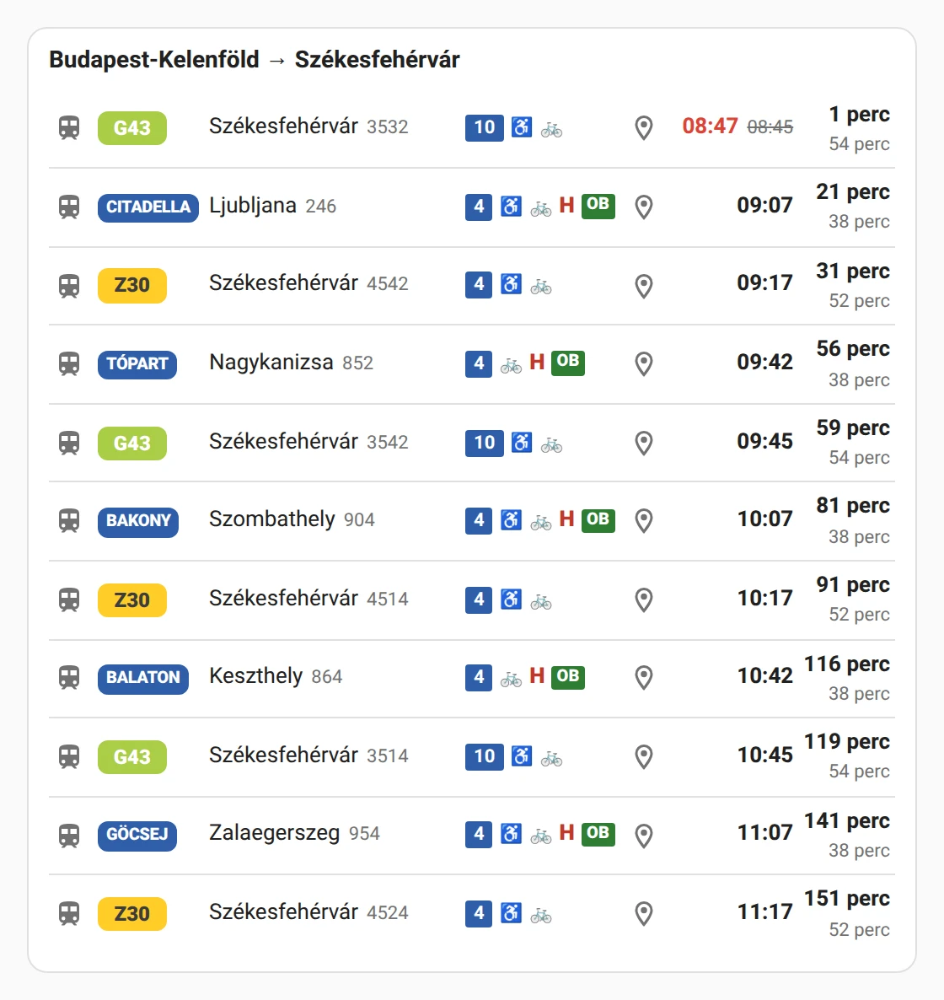

Minden vonat szerepel, amely mindkét állomáson megáll: az elővárosiak (Z30,
G43), az InterCityk és a tovább közlekedő nevesített vonatok (TÓPART,
BAKONY) is.

### 4.5 BKK kártya

Ha egyik mód sincs bepipálva, a kártya a budapesti közösségi közlekedést
mutatja. Itt a Móricz Zsigmond körtér és a Fővám tér közötti összes járat
(M4-es metró, 47-es és 49-es villamos):

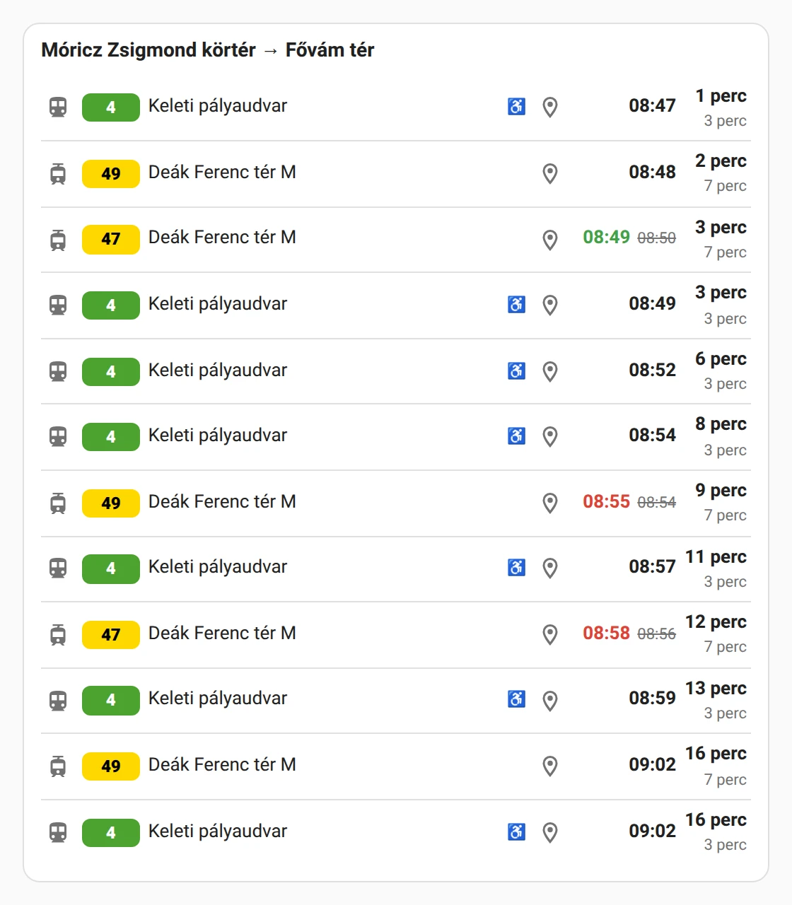

A piros idő késést jelez, mellette áthúzva a menetrend szerinti idő.

### 4.6 Volán kártya

Pipáld be a **Volán** módot, és válassz két buszmegállót. A Volán
menetrend az országos GTFS-ből jön, ezért BKK kulcs nélkül is működik, és
ebben a módban a szerkesztő el is rejti a kulcs sorát.

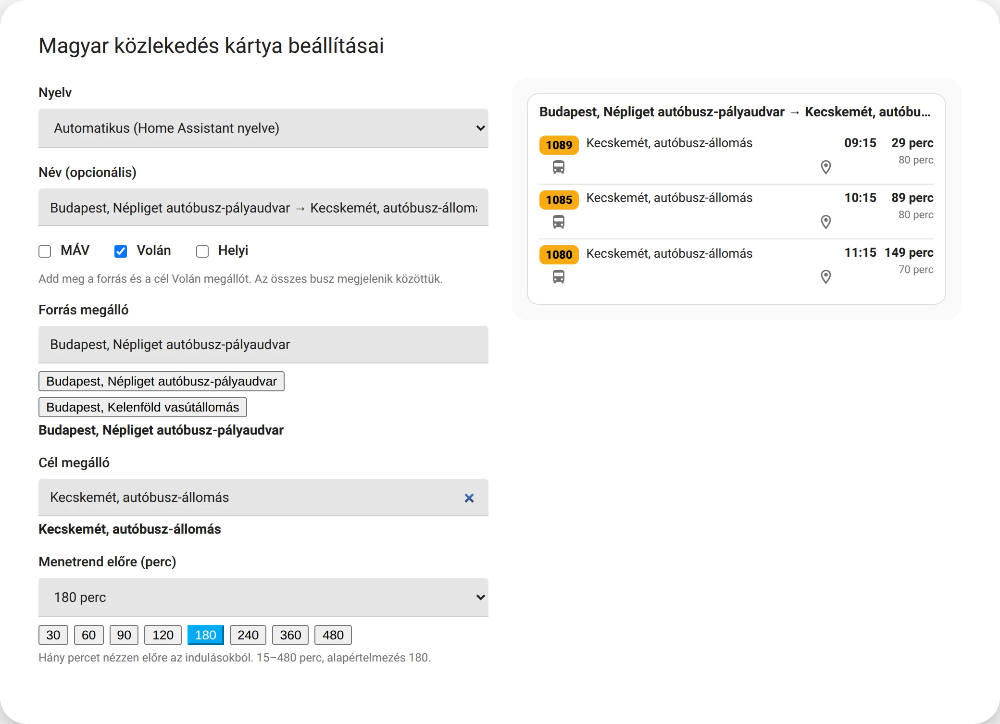

240 perces előretekintéssel a kártya a dashboardon:

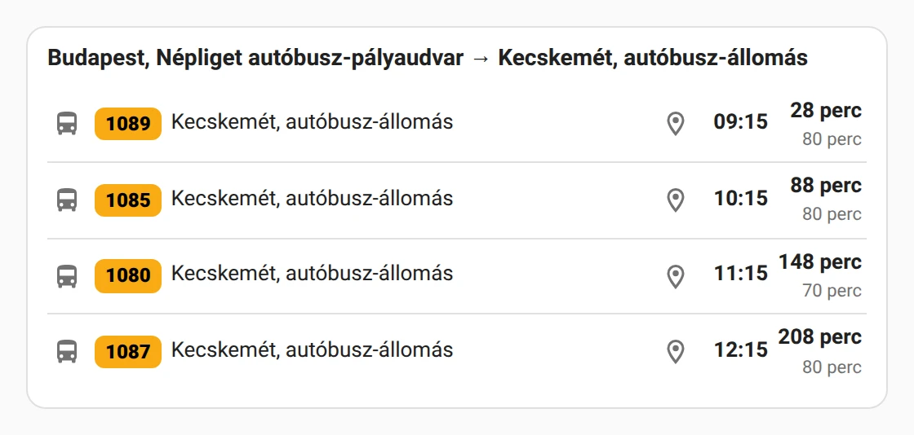

### 4.7 Helyi kártya

Pipáld be a **Helyi** módot, válaszd ki a várost, majd a két megállót.

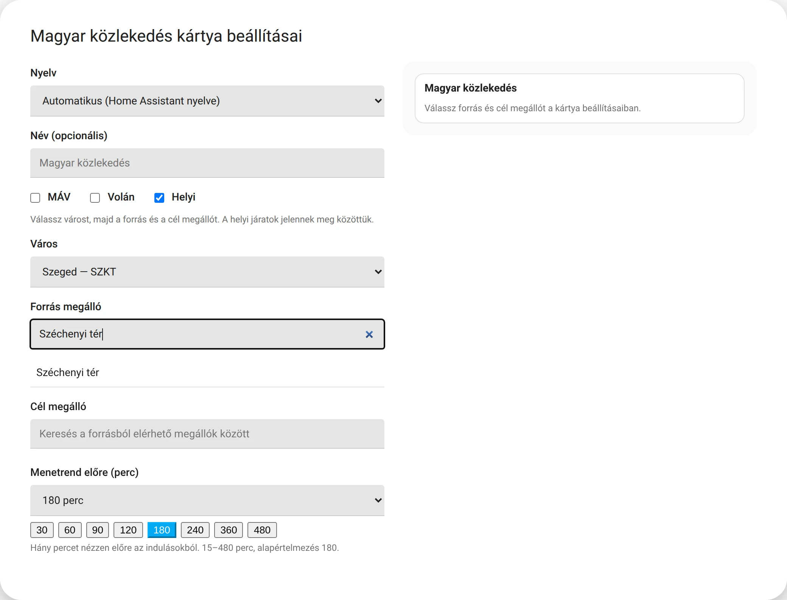

A **Menetrend előre** gyorsgombjai állítják, milyen messzire nézzen előre a
kártya. Itt a *60* egy képernyőn tartja a sűrűn járó villamost:

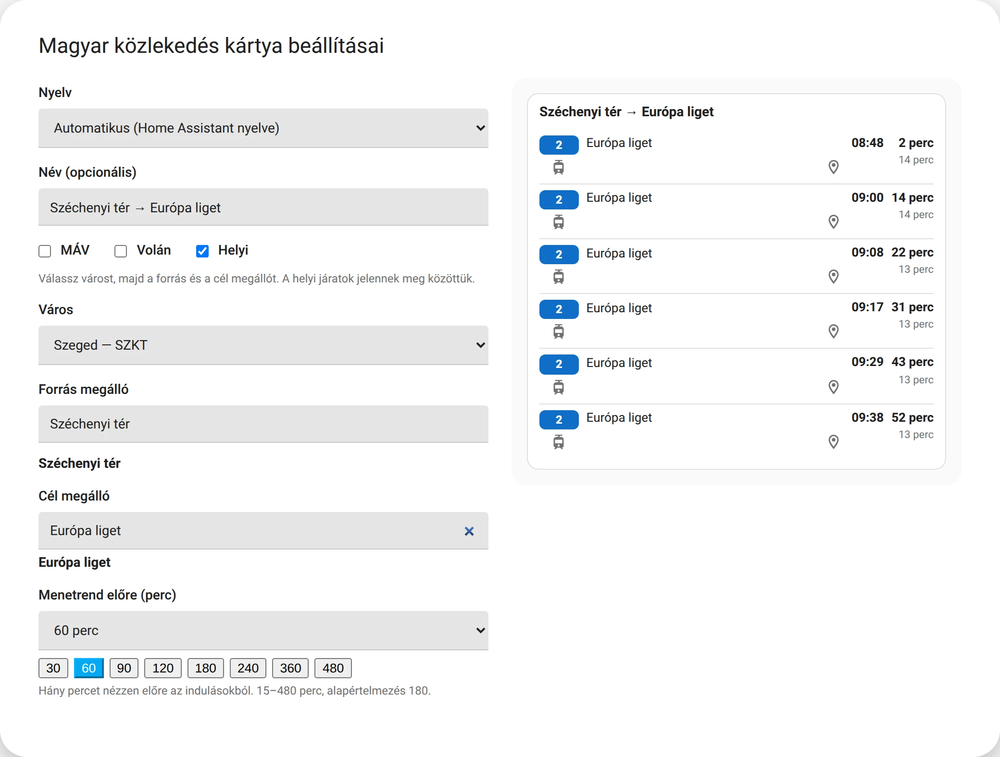

Választható többek között Miskolc, Pécs, Szeged, Szombathely, Veszprém,
Paks, Dombóvár, Budaörs, Hódmezővásárhely, Kaposvár, Kiskunhalas,
Székesfehérvár, Tatabánya, Várpalota, a Kecskeméti Kisvasút, a Bahart
balatoni hajói, valamint a Volánbusz helyi hálózatai, például Sopron vagy
Eger.

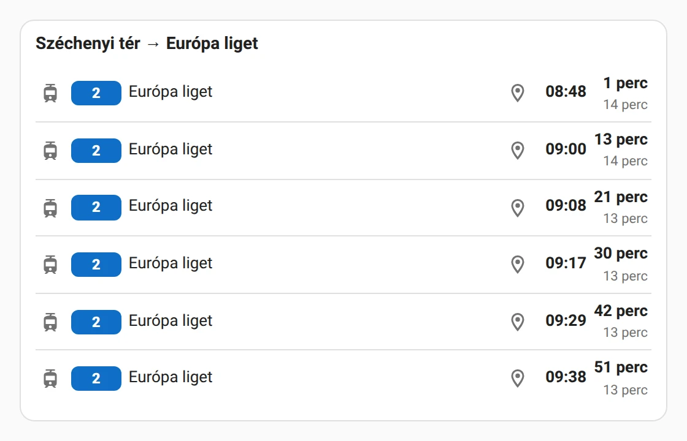

---

## 5. Egy indulási sor részei

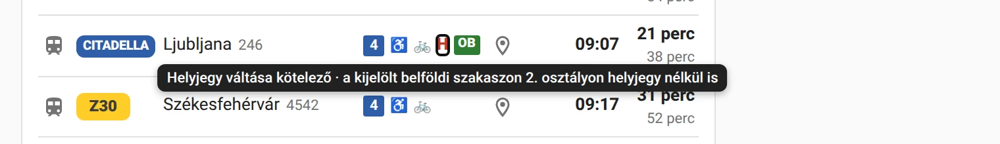

Balról jobbra:

| Elem | Jelentése |
| --- | --- |
| Járműikon | Busz, villamos, troli, metró, vonat vagy hajó. |
| Vonaljelzés | A vonal a saját színeiben (az S, G és Z vonatoknál a budapesti elővárosi színekkel). |
| Célállomás | Merre megy a jármű. MÁV soroknál szürkével a vonatszám is. |
| Kék doboz | A vágány (MÁV, az ELVIRA-ból). |
| ♿ | Akadálymentes, alacsonypadlós jármű. |
| 🚲 | Kerékpár szállítható. |
| **H** | Helyjegy váltása kötelező. A magyarázat azt is megmondja, ha belföldi szakaszon 2. osztályon nem kell. |
| **OB** | Országbérlettel igénybe vehető. |
| Térképgomb | Megnyitja az útvonaltérképet (lásd a [6. fejezetet](#6-az-útvonaltérkép)). A sorra kattintás ugyanezt teszi. |
| Idő | Az indulás ideje. **Piros**, ha késik, mellette áthúzva a menetrend szerinti; **zöld**, ha korábban indul. |
| Visszaszámlálás | Hány perc múlva indul, vagy *most*. |
| Alatta szürkével | A menetidő a célig. |

Ha egy jelre viszed az egeret (vagy rálépsz a billentyűzettel), megjelenik a
magyarázata, mint fent a **H**-nál.

Így frissül a kártya:

- Az indulásokat 45 másodpercenként tölti újra (`refresh`, legalább 20).
- A visszaszámlálás 15 másodpercenként frissül, új lekérdezés nélkül.
- Egy indulás az esedékessége után még egy percig látszik, aztán eltűnik.
- Ha a böngészőfül háttérbe kerül, a kártya leáll, és visszatéréskor
  behozza a lemaradást.

---

## 6. Az útvonaltérkép

Kattints egy sorra vagy a térképgombjára. Megnyílik a térkép a jármű
útvonalával.

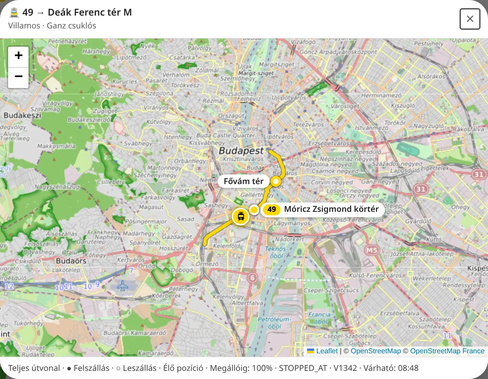

| A térképen | Jelentése |
| --- | --- |
| Színes vonal | A járat teljes útvonala, a vonal színében. |
| Pötty a vonaljelzéssel és a megálló nevével | Itt szállsz fel. |
| Fehér karika a megálló nevével | Itt szállsz le. |
| Kerek járműjel udvarral | Élő GPS-pozíció. |
| Szaggatott szélű járműjel | A menetrendből becsült pozíció. |

A fejléc a vonalat, a célt és a jármű fajtáját mutatja (a BKK-nál a
jármű típusát is, például Ganz csuklós). A lábléc összefoglal: útvonal, felszállás, leszállás, élő
vagy becsült pozíció, hány százalékra van a jármű a megállódtól, a várható
és a menetrend szerinti idő.

A vonatok a saját útvonalukat rajzolják (a MÁV menetrenddel a legjobban,
lásd [3.4](#34-vonatútvonalak-a-térképen-opcionális)):

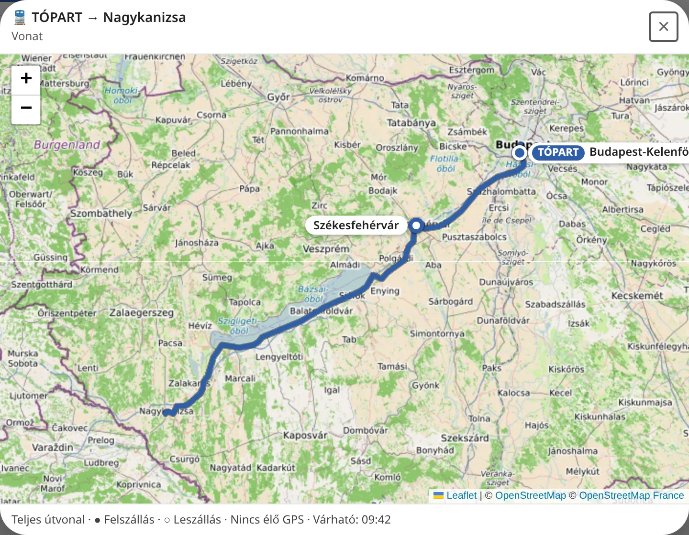

A Volán buszok és a helyi járatok az üzemeltető saját menetrendi adataiból
rajzolják az útvonalat, külső szolgáltatás nélkül:

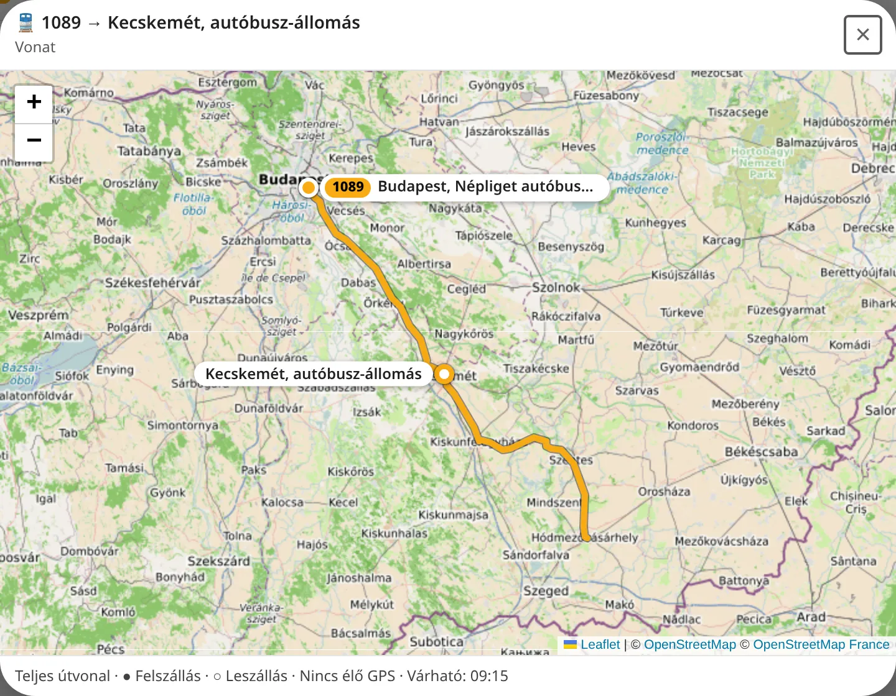

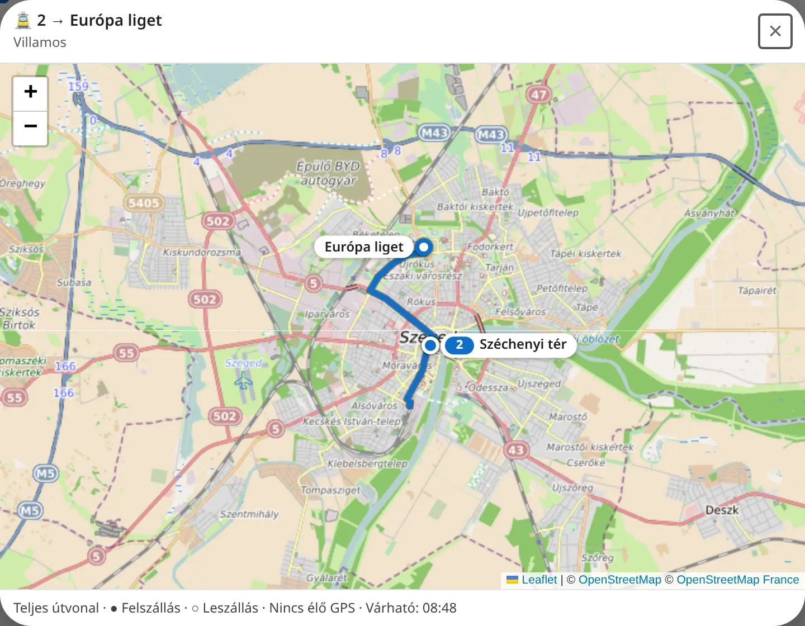

A térképet a **×** gombbal vagy az **Esc** billentyűvel zárhatod be.
Nagyítani a **+** és **−** gombbal, az egérgörgővel vagy két ujjal lehet.

---

## 7. A tervező

A tervező egyszerre keres minden üzemeltetőnél: BKK, MÁV, Volán és a helyi
hálózatok. Üzemmódot nem kell választani.

### 7.1 A tervező hozzáadása

Add hozzá a **Hungarian transit stop planner** kártyát. A szerkesztője
ugyanazokat a mezőket tartalmazza, mint az indulási kártyáé, csak
üzemmód-kapcsolók nélkül. A megállókat üresen is hagyhatod, és magán a
kártyán választhatod ki őket.

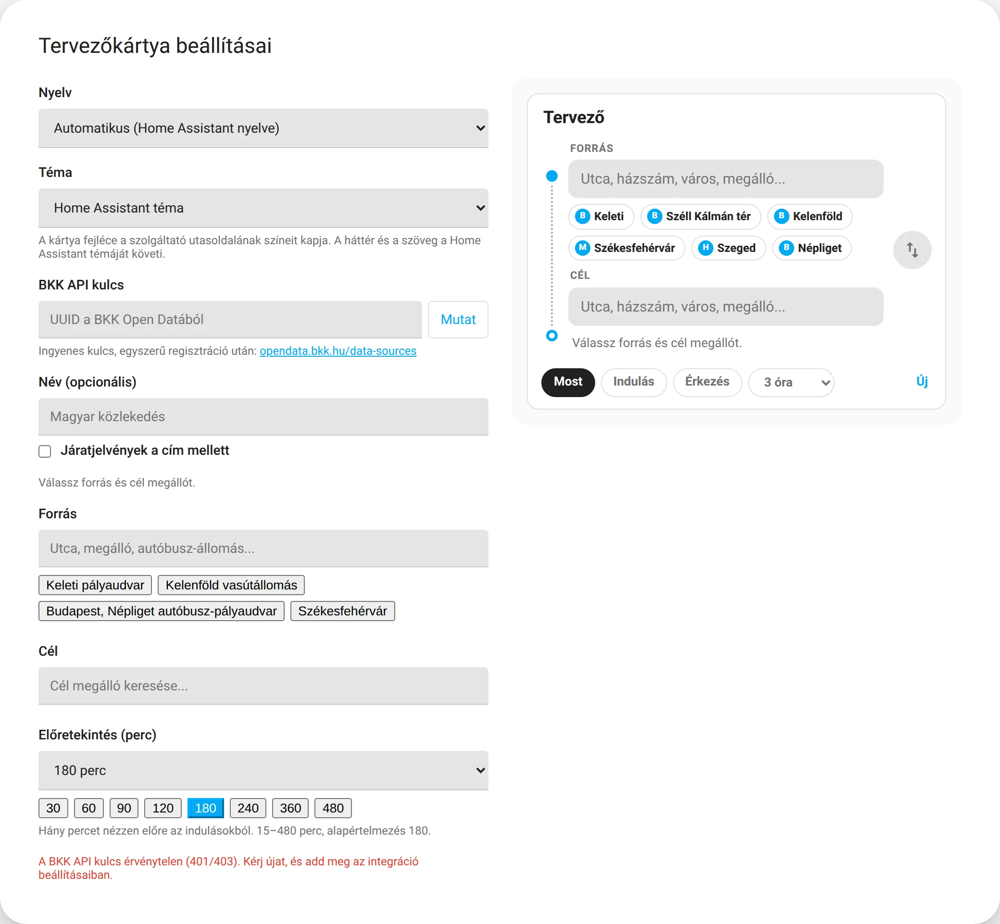

### 7.2 Helyek kiválasztása

Az új tervezőn egy **Forrás** és egy **Cél** mező van. Írhatsz megállót,
utcát házszámmal, települést vagy helyet.

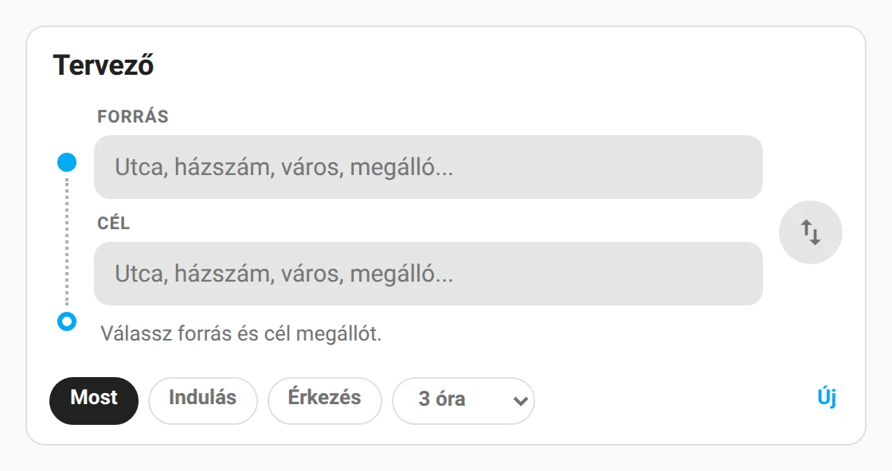

A találatok zárójelben a települést is mutatják, a címeket és a helyeket
pedig külön jelölik. Így a különböző városok azonos nevű megállói nem
keverednek:

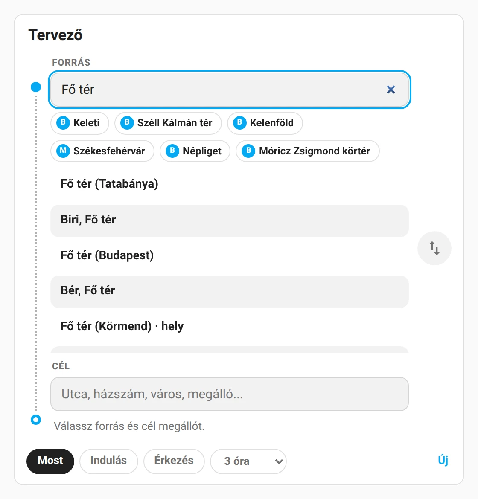

A jobb oldali csere gomb (⇅) felcseréli a forrást és a célt. Az **Új**
mindkettőt törli.

### 7.3 A saját javaslataid

A **Forrás** alatt a tervező azokat a megállókat ajánlja, amelyeket *te*
választasz a leggyakrabban. Az előttük álló betű a hálózatot jelzi:
**B** BKK, **M** MÁV, **V** Volán, **H** helyi hálózat.

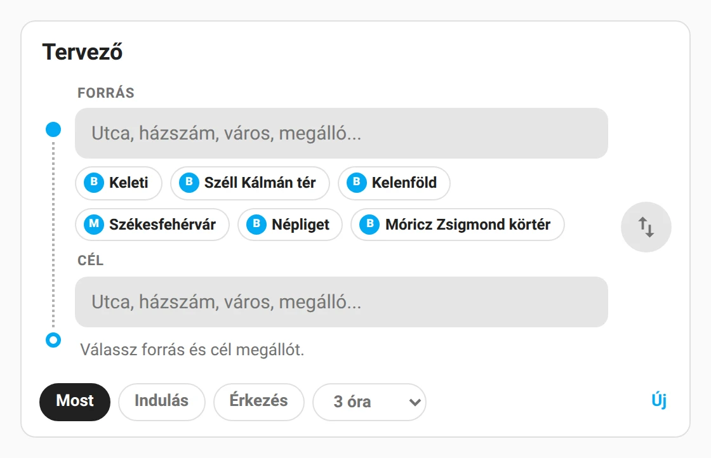

- Minden kiválasztott forrás és cél számít. A gyakori és a friss megállók
  kerülnek előre; egy régi találat súlya 30 naponta feleződik.
- A lista Home Assistant felhasználónként tárolódik: a telefonod és a
  tableted ugyanazt mutatja, más felhasználók pedig nem látják a tiédet.
- Egy új felhasználó addig nem lát javaslatot, amíg nem választ megállót.

### 7.4 Most: élő indulások

**Most** állásban a tervező a két hely közötti összes közvetlen indulást
mutatja, ugyanabban az elrendezésben, mint az indulási kártya, bármelyik
üzemeltetőé is. A **Meddig** mező állítja, milyen messzire néz előre. A
**Térkép** az első indulás útvonalát rajzolja ki.

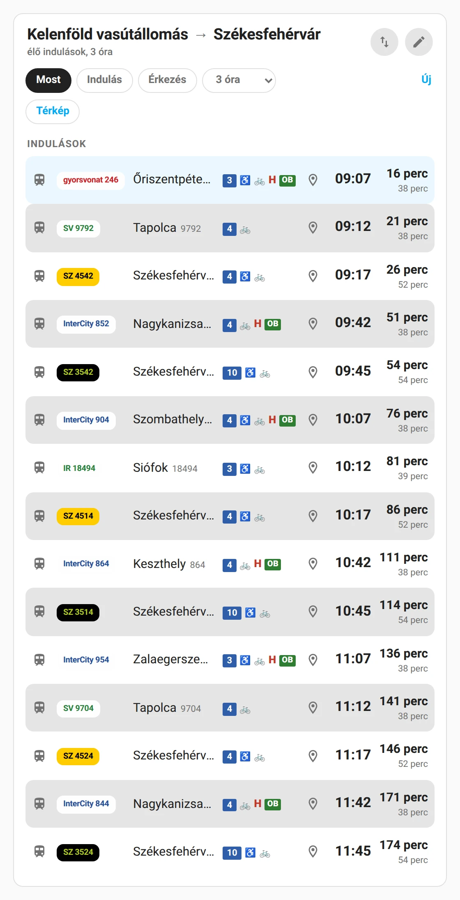

Ha nincs közvetlen járat, vagy egy átszállásos út hamarabb ér oda, a
tervező az **Átszállással** rész alatt azt az útvonalat is mutatja, kis
térképpel és idővonalon az összes szakasszal:

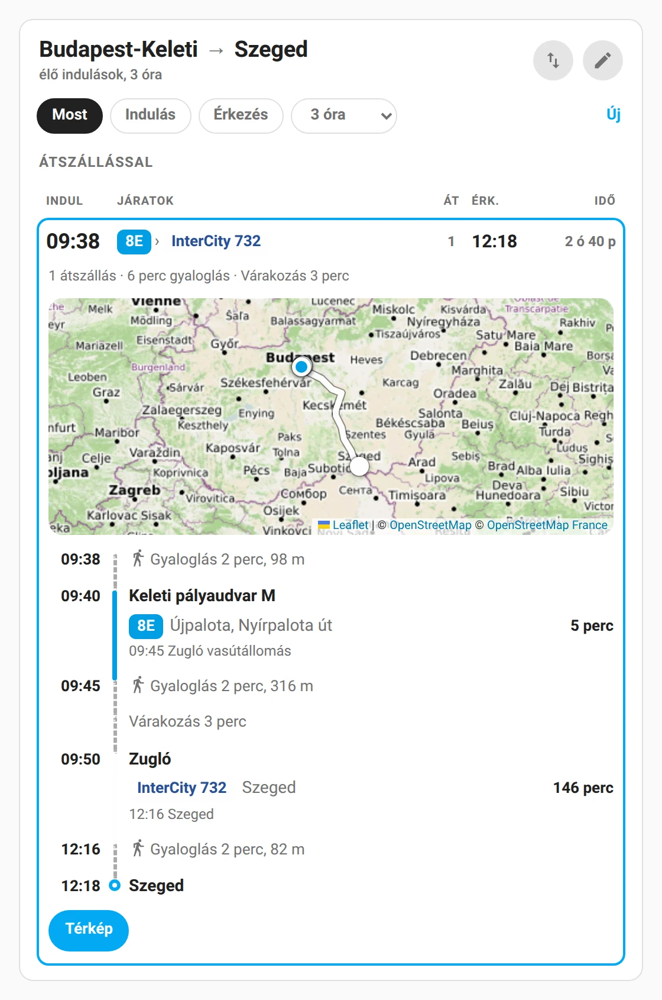

Az idővonalon minden gyaloglás, várakozás és utazás szerepel: az idő, a
megálló, a vonaljelzés és a cél, a menetidő, és hogy hol kell leszállni.

A **Térkép** gomb megnyitja a nagy térképet, minden szakasz a saját
színében:

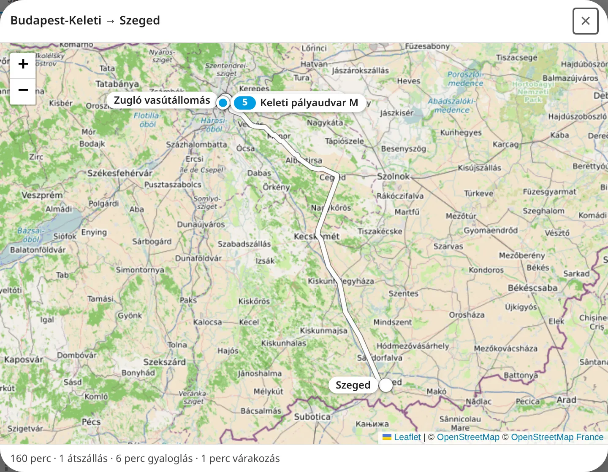

### 7.5 Indulás és Érkezés: útvonalak egy időpontra

Válaszd az **Indulás** vagy az **Érkezés** gombot, majd állítsd be a dátumot
és az időt (ötperces lépésekben). A tervező legfeljebb hat útvonalat
listáz, amelyek ekkor vagy később indulnak, illetve addig megérkeznek. Ha
egy útvonalat egy másik indulásban és érkezésben is megelőz, az kimarad.

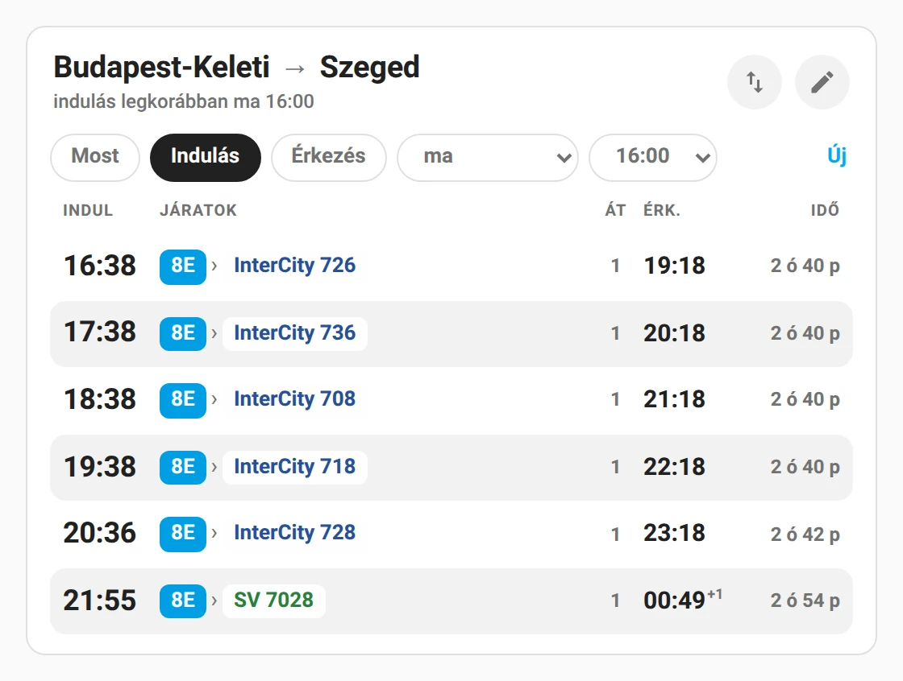

Minden útvonalnál látszik az indulás és az érkezés, az időtartam, a
vonalak színes jelzéssel és köztük a gyaloglás, az átszállások száma,
valamint a gyaloglás és a várakozás ideje. Kattints egyre, hogy kinyíljon:

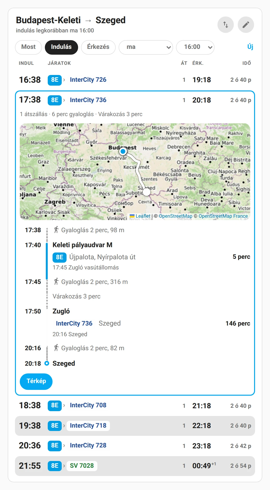

Az **Érkezés** ugyanígy működik, a megadott időponttól visszafelé számolva.
Az az útvonal áll elöl, amelyik a legközelebb ér oda a megadott időhöz:

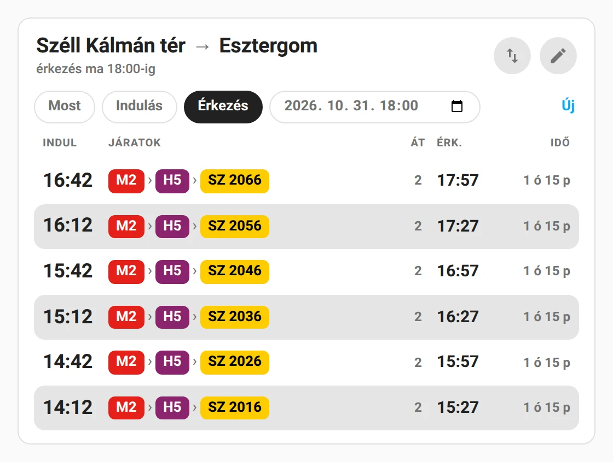

A választott időpont a kártyán marad, amíg meg nem változtatod. A dashboard
konfigurációjába nem kerül bele; újratöltés után a tervező **Most** állásban
indul.

### 7.6 Országon át

A tervező egy útvonalban köti össze az összes hálózatot. A pécsi Kossuth
térről Budapest-Keletibe az első útvonal gyalog megy a pécsi
autóbusz-állomásra, Volán busszal Budapestre, onnan a 107-es busszal és az
M4-es metróval tovább. A következők a 104-es helyi busszal mennek a
vasútállomásra, és onnan a MECSEK InterCityvel:

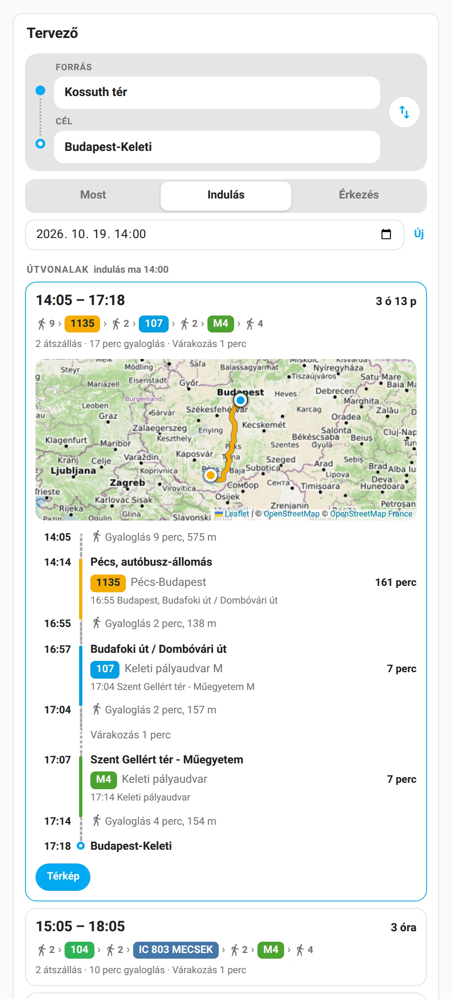

---

## 8. Elrendezés, nyelv, téma

### 8.1 Telefon és keskeny oszlop

Keskeny kártyán minden indulás két sorba törik, így a cél olvasható marad.
Az időoszlopok egymás alatt maradnak.

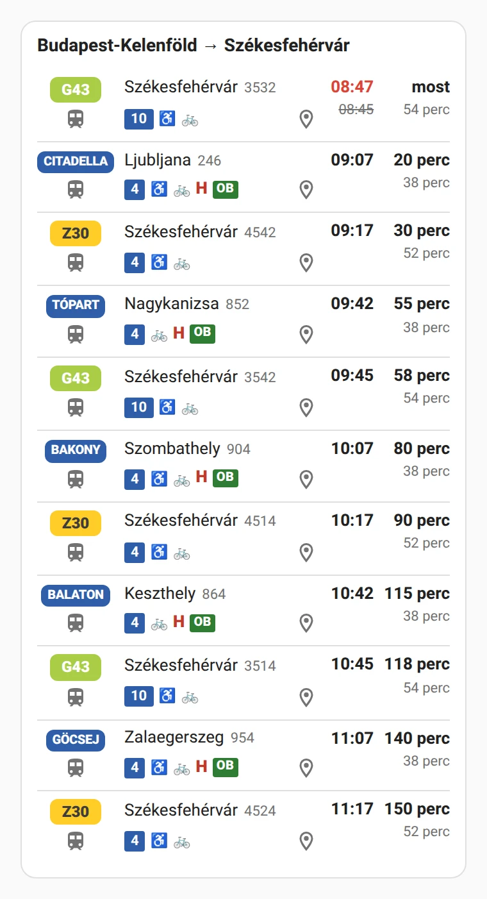

**Szekciós** (sections) dashboardon a kártya szabadon átméretezhető; az
átméretezés nem tölti újra az adatokat.

### 8.2 Nyelv

A kártyák és a szerkesztők magyarul és angolul beszélnek. **Automatikus**
beállítással a Home Assistant felhasználó nyelvét követik. A hibaüzenetek
is.

### 8.3 Sötét téma

A kártyák a Home Assistant témád színeit használják:

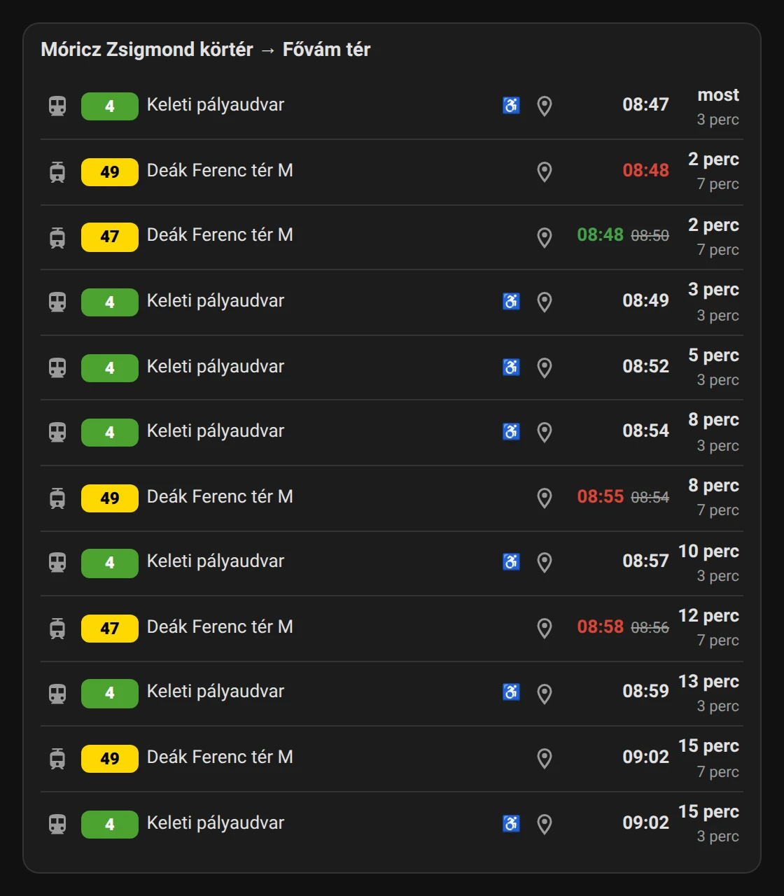

---

## 9. A menetrendek frissen tartása

A Volán és a helyi menetrendek minden kiadással együtt érkeznek. Egy heti
GitHub-folyamat újraépíti őket, és ha valamelyik menetrend változott, új
patch-kiadást ad ki ugyanazzal a kóddal és a friss menetrendekkel. A HACS
ezt szokásos frissítésként kínálja fel; egy kiadás, ha egyszer kint van, már
nem változik.

A saját Home Assistantodon napi frissítéshez kövesd a menetrend-útmutató
[Keeping the GTFS indexes current](../timetables.md#keeping-the-gtfs-indexes-current)
részét. Röviden:

1. Másold a `scripts/` mappát a `/config/hungarian-transport/` alá.
2. Másold a `packages/hungarian_transport.yaml` fájlt a packages mappádba.
3. Indítsd újra. A frissítés minden nap 04:30-kor és minden indulás után öt
   perccel fut, és csak a megváltozott feedeket építi újra.

Egy sikertelen frissítés megtartja az előző menetrendet, és értesítést küld
(lásd [When an update fails](../timetables.md#when-an-update-fails)).

---

## 10. Hibaelhárítás

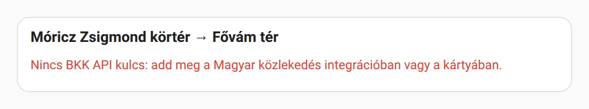

| Ezt látod | Ok | Megoldás |
| --- | --- | --- |
| *Nincs BKK API kulcs: add meg a Magyar közlekedés integrációban vagy a kártyában.* | Egy BKK vagy MÁV kártyának nincs kulcsa. | Add meg a kulcsot az integráció **Konfigurálás** pontjában vagy a kártyaszerkesztőben. |
| *A BKK API kulcs érvénytelen (401/403).* | A BKK elutasítja a kulcsot. | Kérj új kulcsot, és add meg **A BKK kulcsot elutasították** ablakban vagy a **Konfigurálás** alatt. |
| *Nincs közelgő indulás.* | Az előretekintési időben nem indul semmi (gyakran éjjel). | Növeld a **Menetrend előre** értékét, vagy ellenőrizd a megállókat. |
| *Nincs közvetlen járat erre a célra. Elérhető célok: …* | A célba nem megy közvetlen járat a forrásból. | Válassz a felsorolt célok közül, vagy használd a tervezőt. |
| *A menetrend-index nem töltődött le (időtúllépés vagy hálózati hiba).* | A böngésző nem tudta letölteni a Volán vagy a helyi menetrendet. | Töltsd újra az oldalt. Ha marad, nézd meg a **Javítások** alatt, hiányoznak-e fájlok. |
| *A menetrend-index újabb (vN), mint amit ez a kártya ismer. Frissítsd a kártyát.* | A böngésző még a régi kártyát futtatja. | Töltsd újra az oldalt üres gyorsítótárral, vagy frissítsd az integrációt. |
| Nincs vágány, **H** vagy **OB** jel a MÁV sorokon | A MÁV ELVIRA nem válaszolt. | Nincs teendő: a vonatok így is látszanak, a jelek maguktól visszajönnek. |
| Egy vonat térképe egyenes vonal az állomások között | Ehhez a vonathoz nincs útvonaladat. | Add hozzá a MÁV menetrendet ([3.4](#34-vonatútvonalak-a-térképen-opcionális)). |
| „Custom element doesn't exist” frissítés után | A böngésző az új kártya előtt töltötte be az oldalt. | Frissítés után indítsd újra a Home Assistantot, aztán töltsd újra az oldalt. |
| Hiányzik egy buszjárat, amiről tudsz | A hivatalos menetrendben nincs ilyen közvetlen járat (például a székesfehérvári buszok a Népligetről indulnak, nem Kelenföldről). | A kártya csak a hivatalos menetrendet mutatja. Átszállásos útért próbáld a tervezőt. |

---

## 11. Konfigurációs referencia

Mindent, amit a szerkesztő beállít, YAML-ban is megadhatsz.

### Indulási kártya

```yaml
type: custom:hungarian-transport-card
language: auto            # auto, hu vagy en
mav: true                 # vagy volan: true, vagy helyi: true és city: szeged
stopId: BKK_005501024
stopName: Budapest-Kelenföld
destKey: szekesfehervar
destName: Székesfehérvár
minutesAfter: 180         # 15–480
refresh: 45               # másodperc, legalább 20
```

| Kulcs | Alapérték | Leírás |
| --- | --- | --- |
| `language` | `auto` | `auto`, `hu` vagy `en`. |
| `name` | forrás → cél | A kártya címe. |
| `apiKey` | — | A kártya saját BKK kulcsa. Elhagyható, ha az integrációban van kulcs. |
| `mav` / `volan` / `helyi` | `false` | Üzemmód. Legfeljebb egy lehet bekapcsolva; ha egyik sem, BKK. |
| `city` | — | A helyi hálózat azonosítója `helyi` módhoz (`szeged`, `pecs`, `miskolc`, `sopron`, …). |
| `stopId`, `stopName` | — | A forrás, a szerkesztő állítja be. |
| `destKey`, `destName` | — | A cél, a szerkesztő állítja be. |
| `routeIds` | a szerkesztő tölti ki | A célba menő vonalak. |
| `minutesAfter` | `180` | Előretekintés percben (15–480). |
| `refresh` | `45` | Ennyi másodpercenként tölt újra (legalább 20). |
| `favorites` | fő csomópontok | Saját gyorsgombok: `{ id, name }` elemek listája. |
| `volanIndex`, `cityIndex`, `mavIndex` | a kártya mellett | Más menetrend-indexek címe. |

### Tervező

```yaml
type: custom:hungarian-transit-stop-card-plan
language: auto
minutesAfter: 180
```

A tervező ugyanazokat a `language`, `name`, `apiKey` és `minutesAfter`
kulcsokat fogadja. A forrást és a célt a szerkesztőben is megadhatod, vagy
rábízhatod a kártyára.
